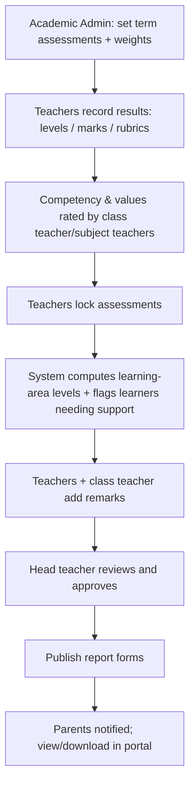

# CBC-SPECIFICATION.md — CBC School Management System

**Client:** Principal of a CBC-based school, Kenya
**Status:** v1.0 draft. Extends `REQUIREMENTS.md`, `DATABASE-DESIGN.md` and `PERMISSIONS.md`.

## 1. Project Brief (from the Principal)

A modern, secure, easy-to-use website that helps the school manage daily activities, learner records, assessments, staff, fees and parent communication, while supporting the **Competency-Based Curriculum**. It must:

| Goal | How the system delivers it |
|---|---|
| Monitor each learner's progress across **learning areas, competencies, values and performance levels** | CBC assessment model (§3), learner progress profile (§5) |
| **Reduce paperwork** | Digital registers, assessments, report forms, invoices, receipts, documents |
| **Improve accuracy** of records | Validation, single source of truth, audit trail, locked assessments |
| Make **reporting easier for teachers** | Fast entry grids, auto-calculated levels, auto-generated report forms and comments helper |
| Let **parents follow progress** | Parent portal + notifications (§6) |
| Work on **computers and phones** | Responsive, mobile-first UI, PWA later |
| **Different dashboards and permissions** for admin, teachers, parents, learners, finance | Role dashboards (§6) + `PERMISSIONS.md` |

## 2. Scope Decisions for CBC

1. **School levels are configurable**, not fixed. Supported structure (enable what the school offers):

```text
Pre-Primary      PP1, PP2
Lower Primary    Grade 1–3
Upper Primary    Grade 4–6
Junior School    Grade 7–9
Senior School    Grade 10–12 (STEM, Social Sciences, Arts & Sports pathways)
```
   The word "learner" is used throughout the UI instead of "student".

2. **Assessment is competency-based.** The primary result is a **performance level**; marks are optional inputs that convert to a level.
3. **Rating scales, learning areas, strands, competencies, values and report-card layouts are configuration**, because KNEC/Ministry guidance changes, especially for Senior School.
4. Default seed data follows the commonly used national scales (below); the school confirms them before go-live.

> **Verify before launch:** performance-level names, point values and Senior School assessment/weighting rules must be confirmed against current KNEC and Ministry of Education guidance and the school's own report form. The seeds here are defaults, not authority.

## 3. CBC Assessment Model

### 3.1 Concepts

```text
Learning Area (subject)
   └── Strand
        └── Sub-strand
             └── Specific Learning Outcome (SLO)
                  └── assessed by: formative tasks, summative tests, projects, practicals, observations
                        └── result = Performance Level (or marks → level)

Cross-cutting (assessed per learner per term):
   • Core Competencies
   • Values
   • Pertinent & Contemporary Issues (PCIs), where the school tracks them
   • Co-curricular activities
```

### 3.2 Performance Levels (default seed, fully editable)

| Level | Code | Points | Descriptor |
|---|---|---|---|
| Exceeds Expectation | EE1 | 8 | Outstanding performance |
| | EE2 | 7 | Very good |
| Meets Expectation | ME1 | 6 | Good |
| | ME2 | 5 | Fair |
| Approaches Expectation | AE1 | 4 | Needs some support |
| | AE2 | 3 | Needs support |
| Below Expectation | BE1 | 2 | Needs significant support |
| | BE2 | 1 | Needs intensive support |

**Mark-to-level conversion** (when a teacher enters marks): the school configures percentage bands per scale, for example 90–100 → EE1, 75–89 → EE2, 58–74 → ME1, and so on. These bands are configuration, not code.

### 3.3 Core Competencies (default seed, editable)
1. Communication and collaboration
2. Critical thinking and problem solving
3. Creativity and imagination
4. Citizenship
5. Digital literacy
6. Learning to learn
7. Self-efficacy

### 3.4 Values (default seed, editable)
Love · Responsibility · Respect · Unity · Peace · Patriotism · Social justice · Integrity

Competencies and values are rated per learner per term using the same performance-level scale (or a simplified scale the school defines), with an optional teacher comment.

### 3.5 Assessment Types (configurable)
| Type | Typical use | Result form |
|---|---|---|
| Formative / classwork | Ongoing checks | Level or short comment |
| CAT / opener / mid-term / end-term | Summative tests | Marks → level |
| Project / portfolio | Skills application | Rubric level |
| Practical / observation | Labs, sports, arts | Rubric level |
| School-Based Assessment (SBA) | Official continuous assessment components | Marks/level per school and KNEC rules |
| National assessments (e.g. KPSEA, KJSEA) | External | Imported/recorded results only |

### 3.6 Rubrics
A **rubric** is a set of criteria with a level descriptor each. Teachers pick a level per criterion; the system derives the overall level using a configurable rule (e.g. rounded average of points, or lowest/highest).

### 3.7 Aggregation Rules (configurable per grade band)
| Need | Default behaviour |
|---|---|
| Learning-area result for a term | Weighted combination of assessments (weights set per school) → points → level |
| Overall learner summary | Average points across learning areas; optional ranking **disabled by default** (CBC discourages ranking; the school may enable class position if it chooses) |
| Progress trend | Points per learning area across terms and years |
| Missing assessment | Excluded and flagged; report cannot be published with unresolved gaps unless marked exempt |

## 4. Functional Requirements (CBC additions)

> IDs continue the master list in `REQUIREMENTS.md`.

### 4.1 Curriculum Setup
- **FR-200** Configure school levels, grades and streams (PP1–Grade 12) and pathways for Senior School.
- **FR-201** Manage learning areas per grade, with strands, sub-strands and specific learning outcomes (optional detail; importable from CSV).
- **FR-202** Define rating scales (levels, codes, points, descriptors) and mark-to-level bands; multiple scales per school (e.g. PP vs Senior).
- **FR-203** Define core competencies, values, PCIs and co-curricular categories.
- **FR-204** Define rubrics and level-derivation rules.
- **FR-205** Define assessment types, weights and aggregation rules per grade band.

### 4.2 Assessment & Recording
- **FR-210** Teachers record assessments per learner per learning area/strand/sub-strand as a level, a mark (auto-converted) or a rubric result.
- **FR-211** Quick-entry screens: class grid for marks/levels; tap-to-select levels on a phone.
- **FR-212** Record **competency** and **values** ratings per learner per term, with optional comments.
- **FR-213** Attach evidence (photo, document, short note) to project/portfolio assessments.
- **FR-214** Teacher remarks per learning area; class teacher and head teacher overall remarks.
- **FR-215** Lock assessments after the deadline; unlock needs a reason and approval (audited).
- **FR-216** Import assessment results from Excel/CSV with validation report.

### 4.3 Progress Monitoring & Reports
- **FR-220** Learner progress profile: levels per learning area over time, competency and values trend, attendance, teacher notes.
- **FR-221** Class and learning-area analysis: level distribution, learners below expectation, improvement/decline lists.
- **FR-222** Flag learners needing support (e.g. BE/AE in two consecutive terms) for the class teacher.
- **FR-223** CBC report form (PDF) with school branding: learning-area levels and remarks, competencies, values, co-curricular, attendance, comments, signature areas, next-term dates and fee balance note (optional).
- **FR-224** Bulk generation, approval workflow (class teacher → head teacher), publication to parents.
- **FR-225** Report-form layout is configurable per level (PP, Lower Primary, Upper Primary, Junior, Senior).
- **FR-226** Comment-bank: reusable remark templates per level to speed up teacher comments (teacher edits before saving; any AI suggestion is optional and always human-reviewed).

### 4.4 Core School Management (from the brief)
Already specified in `REQUIREMENTS.md`: learner registration and records, guardians, staff, classes and streams, attendance, timetable, fees and receipts, announcements and messaging, documents, reports, audit. For this client they are prioritised as follows:

| Priority | Modules |
|---|---|
| Must (MVP) | Learner records, staff, classes/streams, learning areas, CBC assessment & report forms, attendance, parent portal, fees & receipts, announcements, role dashboards |
| Should | Timetable, SMS/email notifications, learner portal, assignments, discipline, school calendar |
| Could (later) | Boarding, library, transport, inventory, medical, M-Pesa integration, PWA |

## 5. Learner Progress View (concept)

```text
Brian Mwangi · Grade 8 East · Term 2, 2026
───────────────────────────────────────────────
Learning Area          T1     T2     Trend
Mathematics            ME1    ME1    ▬
English                ME2    ME1    ▲
Kiswahili              AE1    ME2    ▲
Integrated Science     EE2    EE2    ▬
Social Studies         ME1    AE2    ▼  ⚑ needs support
───────────────────────────────────────────────
Core competencies      Strong: Communication · Needs growth: Digital literacy
Values                 Responsibility ▲  Respect ▬
Attendance             95%
Teacher note           "Participates well in group work…"
```

## 6. Dashboards by Role

| Role | Dashboard highlights |
|---|---|
| **Principal / Administrator** | Enrolment, attendance today, fee collection vs target, learners needing support by grade, assessments pending/locked, report forms awaiting approval, recent activity |
| **Deputy / Academic head** | Assessment completion by class/teacher, level distribution by learning area, unlock requests, attendance exceptions |
| **Teacher** | Today's timetable, "take attendance", pending assessments, my classes' learners flagged for support, quick entry shortcuts |
| **Class teacher** | Class progress overview, comment completion, parent messages, report-form checklist |
| **Finance staff** | Collections today/term, outstanding fees, defaulters, unallocated payments, waivers awaiting approval |
| **Parent/guardian** | Child switcher, latest report form, progress by learning area, attendance, fee balance and receipts, announcements, messages |
| **Learner** | Timetable, assignments, own progress and competencies (age-appropriate view; disabled for lower grades by default), announcements |

## 7. Permission Additions (extends `PERMISSIONS.md`)

| Permission | Roles |
|---|---|
| `curriculum.manage` | Super Admin, Academic Administrator |
| `scales.manage` | Super Admin, Academic Administrator |
| `assessment.record` | Teacher (assigned learning areas/classes), Class Teacher (class) |
| `assessment.lock` / `assessment.unlock` | Academic Administrator (unlock with reason; Principal above threshold) |
| `competency.rate` | Teacher, Class Teacher |
| `remarks.class` / `remarks.principal` | Class Teacher / Principal |
| `progress.read` | Teacher (assigned), Class Teacher (class), Principal, Parent (own children, published only), Learner (own, if enabled) |
| `reportform.generate` / `reportform.approve` / `reportform.publish` | Academic Admin / Principal / Academic Admin |

Rule unchanged: parents and learners see assessment results only after **publication**.

## 8. Database Changes (extends `DATABASE-DESIGN.md`)

Replace the score-only assessment design with a **level-capable** one.

### 8.1 Curriculum tables
| Table | Key columns |
|---|---|
| `school_levels` | id, name (`Lower Primary`), sequence |
| `grade_levels` | *add* `school_level_id`, `default_rating_scale_id` |
| `learning_areas` | id, code, name, school_level_id, is_core, is_active (*replaces/extends `subjects`*) |
| `strands` | id, learning_area_id, grade_level_id, name, sequence |
| `sub_strands` | id, strand_id, name, sequence |
| `learning_outcomes` | id, sub_strand_id, code, description |
| `competencies` | id, name, description, sequence |
| `values_catalogue` | id, name, description, sequence |
| `pcis` | id, name (optional tracking) |

### 8.2 Rating scales
| Table | Key columns |
|---|---|
| `rating_scales` | id, name, kind (`levels/rubric`), is_default |
| `rating_levels` | id, scale_id, code (`EE1`), band_name (`Exceeds Expectation`), points, descriptor, colour, sequence |
| `score_bands` | id, scale_id, min_percent, max_percent, level_id (mark → level conversion) |
| `rubrics` | id, learning_area_id NULL, name, scale_id, derivation_rule (`avg_round/lowest/highest`) |
| `rubric_criteria` | id, rubric_id, name, sequence |

### 8.3 Assessments & results
| Table | Key columns |
|---|---|
| `assessments` | *keep*; add `mode` (`marks/level/rubric`), `scale_id`, `weight_percent`, `counts_to_term` boolean |
| `assessment_targets` | id, assessment_id, class_id, learning_area_id, strand_id NULL, sub_strand_id NULL, outcome_id NULL, max_marks NULL, teacher_id, status, locked_at, locked_by |
| `assessment_results` | id, target_id, learner_id, score NULL, level_id NULL, status (`entered/absent/exempt`), remark, entered_by — unique (target_id, learner_id); CHECK at least one of score/level unless absent/exempt |
| `rubric_results` | id, result_id, criterion_id, level_id |
| `assessment_evidence` | id, result_id, file_id, note |
| `result_changes` | id, result_id, old_score, old_level_id, new_score, new_level_id, reason, changed_by (append-only) |
| `term_learning_area_results` | id, learner_id, term_id, learning_area_id, points numeric, level_id, computed_at, is_override, override_reason |
| `competency_ratings` | id, learner_id, term_id, competency_id, level_id, comment, rated_by |
| `value_ratings` | id, learner_id, term_id, value_id, level_id, comment, rated_by |
| `cocurricular_records` | id, learner_id, term_id, activity, level_id NULL, comment |
| `learner_support_flags` | id, learner_id, term_id, learning_area_id NULL, reason, status, raised_by |
| `report_forms` | id, learner_id, term_id, class_id, class_teacher_remark, principal_remark, status (`draft/approved/published`), template_id, pdf_url, published_at |
| `report_templates` | id, school_level_id, name, layout jsonb |
| `comment_bank` | id, scope (`learning_area/competency/overall`), level_id, text, language |

### 8.4 Rules
- Exactly one result per `(target, learner)`.
- A results row must match its assessment's `mode` (marks need `score`; levels need `level_id`).
- Score→level conversion happens in one shared function so reports and screens always agree.
- Locked targets reject writes; `result_changes` records every correction.
- `term_learning_area_results` is derived (recomputed on lock/override) and never edited by hand without a reason.

## 9. Report Form (A4 layout outline)

```text
[Logo]  SCHOOL NAME                     Term 2 · 2026
Learner: Brian Mwangi   Adm No: 1042   Grade 8 East   Pathway: —
──────────────────────────────────────────────────────────
Learning Area         Level  Points  Teacher's remark
Mathematics            ME1     6     …
English                ME1     6     …
… (one row per learning area)
──────────────────────────────────────────────────────────
Core competencies      (7 rows with level + comment)
Values                 (8 rows with level + comment)
Co-curricular          …
Attendance             Present 58 / 60 days
Class teacher remark   …            Signature / date
Head teacher remark    …            Signature / date
Next term opens: …     Fee balance: KSh …   (optional)
Key: EE=Exceeds · ME=Meets · AE=Approaches · BE=Below expectation
```

## 10. Workflows (CBC specific)



## 11. Build Order for CBC

| Step | Deliverable |
|---|---|
| 1 | Phase 0: repo, auth, RBAC (as in `ROADMAP.md`) |
| 2 | School levels, grades, streams, learning areas, strands (importable) |
| 3 | Rating scales, score bands, competencies, values (with seed data) |
| 4 | Staff, class–learning-area–teacher allocation |
| 5 | Learners, guardians, admission, imports |
| 6 | Attendance |
| 7 | Assessment setup and recording (level/marks/rubric), locking |
| 8 | Aggregation, support flags, progress profile |
| 9 | Remarks, comment bank, report forms (PDF), approval, publication |
| 10 | Parent portal, notifications |
| 11 | Fees, invoices, receipts, finance dashboard |
| 12 | Timetable, assignments, calendar, discipline, then optional modules |

## 12. Questions to Confirm with the Principal

1. Which levels does the school offer (PP1 to Grade 6, to Grade 9, or including Senior School)?
2. What is the school's current report form and assessment calendar (how many assessments per term)?
3. Do you record marks that convert to levels, record levels directly, or both?
4. What weighting do you use between continuous assessment and end-of-term tests?
5. Do you want learner ranking at all (CBC guidance discourages it), or only level summaries?
6. Day school only, or boarding too?
7. How do parents currently pay fees (M-Pesa paybill, bank, cash), and do you need fee tracking at launch?
8. Which channel reaches parents best: SMS, WhatsApp, email, or the app?
9. How many learners, teachers and parents will use the system at launch?

## 13. Impact on Existing Documents

| Document | Change |
|---|---|
| `REQUIREMENTS.md` | CBC requirements FR-200 to FR-226 added by reference (§4 above) |
| `DATABASE-DESIGN.md` | Section 8 above supersedes the marks/results design (§3.5) for this client |
| `PERMISSIONS.md` | Add permissions in §7 |
| `USER-FLOWS.md` | Flow 5 and 6 become the CBC workflow in §10 |
| `UI-UX-SPECIFICATION.md` | "Marks grid" screen gains a level-picker mode; add learner progress profile and competency/values entry screens |
| `ROADMAP.md` | Phase 1 follows the build order in §11 |
| Terminology | "Student" → "Learner" in UI copy; "Marks" → "Assessment" |
