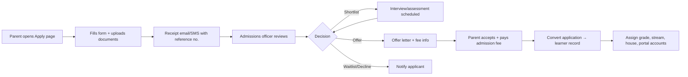

# PRINCIPAL-BRIEF-ADDENDUM.md

Reconciles the Principal's expanded brief ("What I expect the website to contain", CBC assessment expectations, user list, consultation checklist) with the existing documentation. It lists what was already covered, what is new, and what to build first.

## 1. Coverage Check

| Principal's expectation | Status | Where |
|---|---|---|
| **1. Public school website** (home, about, history, leadership, CBC info, news, events, gallery, contacts, calendar) | **New** | §2 |
| Online admissions and application forms | **New** (extends admissions) | §3 |
| **2. Principal's dashboard** (learners, staff, enrolment by grade/stream, attendance, performance, fees, announcements) | Covered | `CBC-SPECIFICATION.md` §6, `UI-UX-SPECIFICATION.md` §5.2 |
| **3. CBC academic management** | Covered, refined here | `CBC-SPECIFICATION.md`, §5 below |
| **4. Parent and learner portal** (report cards, attendance, feedback, fees, announcements, contact school, homework, events) | Covered; add "contact the school" form | `REQUIREMENTS.md` §3.16, §6 below |
| **5. Finance and administration** (fees, receipts, balances) | Covered | `REQUIREMENTS.md` §3.6 |
| Expense records and financial reports | **New** | §4 |
| Staff records and role assignments | Covered | §3.7, `USER-ROLES.md` |
| Inventory, transport, other modules | Covered, optional | Phase 4 |
| **Roles:** CBC coordinator, Admissions officer, System administrator | **New / renamed** | §7 |
| "Not only marks and averages"; no single universal scale; school-configured scale and conversion | Covered | `CBC-SPECIFICATION.md` §2–3 |
| Teacher workflow: year/term/grade/learning area → learner/class → evidence → level or score → feedback → **submit for review** → report | Covered; review step clarified | §5 |
| Consultation checklist (15 questions) | **Merged** | §10 |

## 2. Public School Website (new module)

A public, SEO-friendly site on the school's domain, managed by staff from the admin area (no developer needed for content updates).

### Pages and content
| Page | Content | Managed by |
|---|---|---|
| Home | Hero, welcome message, key stats, latest news, upcoming events, quick links (Apply, Contact, Portal login) | Admin |
| About Us | History, mission/vision/values, leadership team (photos, bios), facilities | Admin |
| Academics / CBC | Curriculum overview, school levels, learning areas, Senior School pathways (STEM, Social Sciences, Arts & Sports), co-curricular, assessment approach in plain language | Admin / CBC coordinator |
| Admissions | Process, requirements, fees summary (optional), key dates, **online application form** | Admissions officer |
| News & announcements | Articles with categories, publish/schedule | Admin |
| Events & calendar | Public calendar view, downloadable term dates | Admin |
| Gallery | Albums with captions | Admin (photo consent rules, §8) |
| Contact | Address, map, phone, email, contact form, opening hours | Admin |
| Portal login | Link to parent/staff/learner login | — |
| Policies | Privacy notice, terms, safeguarding statement | Admin |

### Requirements
- **FR-230** Content management: pages, news posts, events, gallery albums, leadership profiles, downloadable documents (e.g. fee structure PDF, admission form).
- **FR-231** Rich-text editor with image upload, draft/publish/schedule, and preview.
- **FR-232** Public site is mobile-first, fast (LCP ≤ 2.5 s on 4G), accessible and SEO-ready (titles, meta, sitemap, Open Graph, structured data).
- **FR-233** Contact form with spam protection (honeypot + rate limit + CAPTCHA); messages go to a staff inbox and optionally email/SMS.
- **FR-234** Public calendar shows only events flagged "public".
- **FR-235** Site theme (logo, colours) configured in Settings; custom domain supported.
- **FR-236** Analytics (privacy-friendly) for page views and application-form completion.
- **FR-237** Announcements flagged "public" appear on the website; others stay in the portal.

### Architecture note
Keep the public site and the authenticated app in **one codebase** but separate routes/layouts (`/` public, `/app` authenticated). Public pages are server-rendered or statically generated for SEO. In the current stack, use either a Vite-based prerender/SSG setup or a separate Next.js app for the public site. **Recommendation:** Next.js (or Astro) for the public site and the existing React + Vite app for the portal, both calling the same API, so SEO is solved without complicating the portal.

## 3. Online Admissions (new module)

### Flow


### Requirements
- **FR-240** Public application form per intake/grade: learner details, previous school, guardian details, documents (birth certificate, report forms, passport photo), declarations and consent.
- **FR-241** Save-and-resume for incomplete applications (via emailed link).
- **FR-242** Application statuses: submitted → under review → interview/assessment → offered → accepted → enrolled / waitlisted / declined / withdrawn.
- **FR-243** Admissions officer dashboard: filters by grade, status, intake; bulk status updates; notes; internal comments.
- **FR-244** Capacity control: seats per grade/stream and waitlist ordering.
- **FR-245** Offer letters and acknowledgement receipts generated as PDF; templates configurable.
- **FR-246** One-click **convert to learner**: copies data, creates guardian records and portal invitations, generates admission number and admission invoice.
- **FR-247** Optional application fee with payment tracking.
- **FR-248** Duplicate detection (name + DOB + guardian phone).
- **FR-249** Admission window dates and "applications closed" state.

### Data additions
`admission_intakes`, `applications`, `application_guardians`, `application_documents`, `application_status_history`, `interviews`, `offers`.

## 4. Finance Additions: Expenses & Financial Reports (new)

### Requirements
- **FR-250** Expense categories (salaries, utilities, maintenance, supplies, transport, etc.) and vendors/suppliers.
- **FR-251** Record expenses: date, category, vendor, amount, payment method, reference, attachment (receipt/invoice), approver.
- **FR-252** Approval thresholds: expenses above a configurable amount require Principal approval; the recorder cannot approve their own entry.
- **FR-253** Budgets per category per term/year, with actual vs budget tracking.
- **FR-254** Petty cash register.
- **FR-255** Reports: income vs expenditure, collections by category, outstanding fees, cash flow summary, expense by category/vendor, budget variance, term and annual summaries; export to PDF/Excel.
- **FR-256** Bank/M-Pesa reconciliation view (Phase 5 for automatic matching).
- **FR-257** Payroll is **out of scope** for v1 (record salary expense totals only); revisit later.

### Data additions
`expense_categories`, `vendors`, `expenses`, `expense_approvals`, `budgets`, `budget_lines`, `petty_cash_entries`.

> This is a school-operations ledger, not a full accounting system. If the school's accountant needs double-entry books, plan an export to their accounting software.

## 5. CBC Assessment Workflow Refinement

The principal's example maps to the following. Changes to the earlier design are marked ✱.

| Step (from brief) | System behaviour |
|---|---|
| 1. Select year, term, grade, learning area | Context picker, limited to the teacher's allocations |
| 2. Select learner or class | Class grid for bulk entry or single-learner view |
| 3. Record assessment evidence (projects, practicals, tests) | ✱ Each assessment target can hold **evidence**: files, photos, notes, rubric, linked activity; evidence is stored per learner |
| 4. Record performance level or score per configured assessment | Mode (`level / marks / rubric`) set per assessment; score → level conversion from the school's configured scale; **no universal scale** is hard-coded; scales are assigned per grade band |
| 5. Add feedback on competencies, strengths, areas to improve | ✱ Structured feedback fields: **strengths**, **areas for improvement**, competency ratings, values, free-text remark |
| 6. Submit for review by administrator | ✱ Status flow: `draft → submitted → returned / approved → locked → published` |
| 7. Generate learner progress report in the approved format | Report templates per level; PDF generation |

### Review chain (configurable)
```text
Teacher submits
   → CBC Coordinator reviews completeness and moderation (optional)
   → Deputy Principal / Academic head approves
   → Principal approves report forms
   → Published to parents
```
Each school chooses which stages are active. Returned items carry a reason, and the teacher is notified.

### Data additions
- `assessment_targets.status` → `draft/submitted/returned/approved/locked`
- `assessment_reviews` (target_id, reviewer_id, decision, comment, decided_at)
- `learner_feedback` (learner_id, term_id, learning_area_id, strengths, areas_for_improvement, next_steps)
- `moderation_samples` (optional): CBC coordinator samples work for quality checks

### Requirement additions
- **FR-260** Submit-for-review workflow with return/approve and notifications.
- **FR-261** Strengths / areas-for-improvement / next-steps fields per learner per learning area, feeding the report form.
- **FR-262** CBC coordinator dashboard: completion by class and learning area, overdue submissions, moderation queue, level distribution, learners flagged for support.
- **FR-263** Assessment calendar: planned assessment activities per term with due dates and reminders.
- **FR-264** Configurable rating scale per grade band; admins can change scales for a **new** term without altering past reports (scales are versioned).

## 6. Parent & Learner Portal Additions
- **FR-270** "Contact the school" form inside the portal (routes to office or class teacher); replies appear in the thread.
- **FR-271** Homework/projects feed with due dates, resources and submission (learner or parent, per age group).
- **FR-272** Teacher feedback visible per learning area on published reports and progress view.
- **FR-273** Event and calendar view with reminders; add-to-phone-calendar (ICS).
- **FR-274** Fee statements, receipts and payment history (existing), plus downloadable statements.
- **FR-275** Multi-child accounts with a child switcher (already designed) and per-guardian visibility flags.
- **FR-276** Learner view is age-appropriate; lower grades default to **parent-only**.

## 7. Roles (additions and renames)

| Brief role | Mapping in `USER-ROLES.md` | Change |
|---|---|---|
| Principal | Principal | None |
| Deputy principal | Deputy Principal | Add academic supervision permissions (view all assessments, approve submissions) |
| **CBC coordinator** | **New role** | See below |
| Teacher | Teacher | None |
| Class teacher | Class Teacher | Add consolidated progress view and class report-form checklist |
| Bursar | Accountant / Bursar | Add expenses, budgets and petty cash |
| **Admissions officer** | Registrar / Admissions Officer | Extend with applications workflow |
| Parent/guardian | Parent / Guardian | Add contact form, homework |
| Learner | Student → **Learner** | Rename in UI |
| **System administrator** | Super Administrator | Rename in UI; manages accounts, permissions, backups, settings. **Should not read learner assessments or finances by default** |
| Website content editor (optional) | **New role** | Edits public pages, news, gallery, events only |

### CBC Coordinator (new)
- **Can:** manage curriculum configuration (learning areas, strands, rubrics, rating scales with admin approval), view all assessments, run moderation, review/return submissions, see CBC analytics, manage report templates, view learners flagged for support.
- **Cannot:** edit finance, manage users, view medical/discipline details, change locked results without the unlock workflow.

New permissions: `website.manage`, `website.publish`, `applications.read/review/decide/convert`, `expenses.*`, `budgets.*`, `assessment.review`, `assessment.moderate`, `curriculum.manage`, `contact_messages.read`.

## 8. Privacy and Safety Considerations for the Public Side

| Risk | Control |
|---|---|
| Photos of children on the public gallery | Written guardian consent captured at admission; consent flag on each learner; only consented learners may appear; no full names with photos; ability to remove on request |
| Applicant personal data (ID, birth certificate, photos) | Stored privately, access limited to admissions staff, retention schedule for unsuccessful applicants (e.g. delete after 12 months unless consent), privacy notice on the form |
| Spam/bots on forms | Rate limiting, CAPTCHA, email/SMS verification of the applicant contact |
| Malicious uploads | MIME/size checks, virus scan, no public file URLs for applications |
| Contact form abuse/leakage | Server-side validation, no emails exposed to scrapers |
| Public pages leaking internal data | Strict separation: public APIs are read-only, whitelist fields, no authenticated data |
| Defacement | Separate editor role, review before publish for sensitive pages, audit log of changes |

## 9. Updated Delivery Priority

The principal listed five areas. Recommended sequence, with the reason for each:

| Order | Deliverable | Why |
|---|---|---|
| 0 | Phase 0 foundation (auth, RBAC, audit, app shell) | Everything depends on it |
| 1 | **CBC academic management** + learner/staff/class records + attendance | "The most important part" |
| 2 | **Parent & learner portal** (reports, attendance, announcements, contact) | Parents see value immediately |
| 3 | **Finance** (fees, receipts, balances) | Core to daily operations; expenses and reports follow |
| 4 | **Principal dashboard** (grows with each module; first version in step 1) | Leadership visibility |
| 5 | **Public website + online admissions** | Visible and valuable, but independent of core records; build a *lean* site early (Home, About, Contact) if the school needs an online presence sooner |
| 6 | Expenses/budgets, transport, inventory, boarding, library | As required |

**Lean public-site option for MVP:** Home, About, News, Contact, Admissions information with a simple enquiry form. Defer the full CMS, gallery and full online application workflow to a later release if timelines are tight.

### Revised roadmap impact (`ROADMAP.md`)
| Phase | Adds |
|---|---|
| Phase 1 | CBC workflow refinements (§5), CBC coordinator role, principal dashboard v1 |
| Phase 2 | Parent portal additions (§6) and finance; expenses in sprint S9+ |
| Phase 3 | Public website CMS (FR-230–237) and online admissions (FR-240–249) |
| Phase 4 | Expenses, budgets, petty cash reports (FR-250–257) if not delivered earlier |

## 10. Merged Consultation Checklist (with recommended default assumptions)

Use this in the management meeting. If the school can't answer yet, development proceeds on the **default** and the item stays open.

### 1. School structure
| Question | Default assumption until answered |
|---|---|
| Which grades are offered? | Configurable PP1–Grade 12; enable only what the school runs |
| How many learners, streams, teachers? | Design for 1,500 learners / 80 staff; scale tested to 3,000 |
| Day, boarding, or both? | Day school; boarding is an optional later module |

### 2. CBC assessment
| Question | Default |
|---|---|
| Current assessment and report-card formats? | **Need a sample.** Build the template from the school's real form |
| How are performance levels recorded per grade/learning area? | Level and marks both supported; mode set per assessment; scales per grade band |
| Who enters, checks, approves? | Teacher → CBC coordinator (optional) → Deputy → Principal |

### 3. Admissions and fees
| Question | Default |
|---|---|
| Online applications? | Yes, phase 3; enquiry form earlier |
| Fee structures, payment methods, receipt format? | Manual recording (cash, bank, M-Pesa reference) first; M-Pesa integration later; need sample receipt and fee structure |
| Transport, boarding, meals, inventory? | Optional modules after the MVP |

### 4. Parents and communication
| Question | Default |
|---|---|
| Parents log in to view reports, attendance, fees? | Yes |
| Channel for announcements? | In-app + email at launch; SMS added with provider budget; WhatsApp later |
| Separate accounts for multiple children? | One parent account linked to several children |

### 5. Deployment and access
| Question | Default |
|---|---|
| Existing domain and website? | Plan a new site on the school's domain; keep the old one until cut-over |
| Who manages the system; devices and internet? | Name a **system champion** (e.g. deputy or ICT teacher); design for low-end Android phones and unstable connections |
| Who may view or change sensitive records? | Per `PERMISSIONS.md`, reviewed and signed off by the Principal |

**Additional items the brief didn't ask but we need:**
1. Written guardian consent for photos and data processing, and who the school's data-protection contact is.
2. Budget for hosting, domain, SMS and any payment-gateway fees.
3. Who supplies existing learner data, in what format, and the cut-off date for migration.
4. Target go-live term and any dates to avoid (exams, report-card weeks).

## 11. Documents to Update (tracking)

| Document | Update needed |
|---|---|
| `REQUIREMENTS.md` | Reference FR-230 to FR-276 from this addendum |
| `USER-ROLES.md` | Add CBC Coordinator, Website Content Editor; rename Student → Learner |
| `PERMISSIONS.md` | Add permissions in §7 |
| `DATABASE-DESIGN.md` | Add admissions, expenses, website (`pages`, `posts`, `galleries`, `media`, `contact_messages`) and assessment-review tables |
| `API-SPECIFICATION.md` | Add `/public/*` (unauthenticated, read-only), `/applications`, `/expenses`, `/website/*`, `/assessment-reviews` |
| `UI-UX-SPECIFICATION.md` | Add public site layouts, application form wizard, CMS editor, CBC coordinator dashboard |
| `SECURITY.md` | Add public-form, consent and applicant-data controls from §8 |
| `TESTING.md` | Add E2E: submit application → convert to learner; submit-for-review chain; public-site accessibility and SEO checks |
| `ROADMAP.md` | Apply §9 |
