# ROADMAP.md

Delivery plan for HSMS. Estimates assume **1–2 developers**, working part-time to full-time; scale accordingly. Dates are relative (weeks from project start) because school calendars (term dates) drive the real launch window.

## 1. Guiding Principles
1. **Ship vertical slices** (database → API → UI → tests) rather than layers.
2. **Pilot with one real school early**; adapt to how they actually work.
3. **Launch at a term boundary**, never mid-term; avoid exam and report-card weeks.
4. **Marks, attendance and fees come first** because they are the daily and highest-risk workflows.
5. **Security and audit from the start**, not bolted on.

## 2. Phase Overview

```mermaid
gantt
  title HSMS Delivery Plan (weeks)
  dateFormat  X
  axisFormat  W%s
  section Foundation
  Phase 0 Setup & design        :0, 3
  section Core
  Phase 1 Core academics (MVP)  :3, 12
  Phase 2 Finance               :15, 7
  section Pilot
  Pilot / UAT / parallel run    :20, 8
  section Operations
  Phase 3 School operations     :28, 10
  Phase 4 Additional modules    :38, 10
  section Advanced
  Phase 5 Integrations & mobile :48, 10
```

| Phase | Focus | Duration (est.) | Outcome |
|---|---|---|---|
| 0 | Foundations | 2–3 wks | Repo, CI, schema skeleton, design system |
| 1 | Core academics (MVP part 1) | 10–12 wks | Students → report cards |
| 2 | Finance (MVP part 2) | 6–8 wks | Fees, payments, receipts |
| Pilot | UAT + parallel term | 6–8 wks (≥ 1 term) | Proven at a real school |
| 3 | School operations | 8–10 wks | Timetable, boarding, houses, discipline, comms |
| 4 | Additional modules | 8–10 wks | Library, transport, medical, inventory |
| 5 | Integrations & scale | 8–10 wks | M-Pesa, SMS, PWA, analytics |

> **Scope decision:** the SRS placed finance in Phase 2, and REQUIREMENTS.md includes fees in the MVP. This roadmap treats MVP = Phases 1 + 2 together, but delivers them sequentially so academic features can be piloted first.

## 3. Phase 0: Foundations (Weeks 0–3)

| Task | Deliverable |
|---|---|
| Confirm requirements with the pilot school; settle open questions (grading model, day/boarding, SMS budget) | Signed-off MVP scope |
| Monorepo setup (pnpm workspaces), TypeScript, ESLint, Prettier, Husky | Repo |
| CI pipeline (lint, test, build), preview deploys | Green pipeline |
| Docker Compose: Postgres, Redis | One-command dev environment |
| Database baseline: migrations tooling, `users/roles/permissions/audit_logs`, seed script | Migration 001 |
| Auth skeleton: login, refresh, `/me`, permission middleware | Working RBAC |
| Design system: tokens, app shell, core components (Button, Input, DataTable, Dialog) | Storybook/preview |
| Error handling, logging, request IDs, OpenAPI generation | Platform conventions |

**Exit criteria:** a user can log in, see a role-based empty dashboard, and every request is logged and permission-checked.

## 4. Phase 1: Core Academics (Weeks 3–15)

| Sprint (2 wks) | Scope (FR refs) | Key deliverables |
|---|---|---|
| S1 | School profile, academic years/terms, grades, streams, pathways, subjects (FR-020–026, FR-180–181) | Setup screens and APIs |
| S2 | Staff/teacher records, class–subject–teacher allocation (FR-070–072) | Teacher assignments |
| S3 | Students, guardians, admission wizard, CSV import, documents (FR-010–017) | Admission to enrolment |
| S4 | Attendance, parent absence notification (in-app first) (FR-050–053) | Mobile attendance UI |
| S5 | Assessments, grading scales, marks grid, import, locking, unlock requests (FR-030–036) | Marks entry with audit |
| S6 | Results computation, positions, analysis, report-card PDF, comments, approvals, publishing (FR-037–040) | End-to-end term results |
| (buffer) | Admin dashboard, teacher dashboard, global search, exports, bug-fixing, security pass (FR-170–173, FR-191) | Hardening |

**Exit criteria**
- A full exam cycle completes in staging with real-sized data (1,200 students).
- Report cards match the school's manual calculation for a 100-student sample.
- Authorisation matrix tests pass; E1–E6 E2E journeys green.

## 5. Phase 2: Finance (Weeks 15–22)

| Sprint | Scope | Deliverables |
|---|---|---|
| S7 | Fee categories, structures, invoice generation, student fee accounts (FR-060–061, FR-064) | Term invoicing |
| S8 | Manual payments (cash/bank/M-Pesa reference), receipts PDF, reversals, statements (FR-062–063, FR-069) | Bursar workflow |
| S9 | Waivers/bursaries with approval, arrears/defaulters, collection reports, dashboard cards, parent fee view, SMS/email reminders (FR-065–067) | Finance reporting |

**Exit criteria:** balances reconcile with the bursar's records to the shilling for a sample term; E7–E8 journeys green; ledger tests pass; append-only DB permissions verified.

## 6. Pilot & Hardening (Weeks 20–28, overlapping Phase 2)

| Activity | Detail |
|---|---|
| Data migration | Import real students/guardians/staff; clean duplicates |
| Training | Role-based sessions (admin, teachers, bursar, parents); quick-start guides, short videos |
| UAT | Scripts from TESTING.md §11 |
| Parallel run | One full term alongside existing process |
| Security review | Pen test, backup/restore drill, privacy notice and consent text |
| Go-live | Switch at the next term start; hypercare for 2 weeks (daily check-ins, quick-fix SLA) |

**Exit criteria (MVP launch):** UAT sign-off by Principal, Academic Admin and Bursar; no open S1/S2 defects; support process agreed.

## 7. Phase 3: School Operations (Weeks 28–38)

| Module | Scope (FR refs) |
|---|---|
| Timetable | Periods, rooms, class/teacher views, conflict detection (FR-080–083) |
| Assignments | Create, submit, grade, feedback (FR-163) |
| Communication | Announcements targeted by audience, bulk SMS/email, teacher–parent messages, notification log (FR-150–154) |
| Calendar | Events and term dates (FR-190) |
| Discipline | Incidents, actions, parent notification, history (FR-100–104) |
| Houses | Houses, points, leaderboard (FR-094–095) |
| Boarding | Dormitories, beds, allocation, roll call, exeats (FR-090–093) |
| Student portal | Timetable, results, assignments (FR-162) |

## 8. Phase 4: Additional Modules (Weeks 38–48)

| Module | Scope |
|---|---|
| Library | Catalogue, loans, fines, overdue (FR-120–123) |
| Medical | Profiles, visits, restricted access, break-glass (FR-110–112) |
| Transport | Vehicles, routes, assignments, fees (FR-130–133) |
| Inventory & assets | Assets, stock, movements (FR-140–142) |
| Staff management | Leave, staff attendance, documents (FR-073) |
| Document management | Categories, access control, signed links (FR-193) |

## 9. Phase 5: Integrations & Advanced (Weeks 48–58)

| Feature | Notes |
|---|---|
| **M-Pesa Daraja C2B** | Paybill with admission number as account; callbacks, reconciliation, unallocated queue (FR-068) |
| **SMS gateway** | Africa's Talking or similar; delivery reports; cost tracking |
| Email & WhatsApp Business | Templates, opt-in |
| PWA | Installable, offline mark entry/attendance drafts, push notifications |
| Analytics | Cohort trends, subject comparisons, at-risk student flags |
| AI-assisted features (optional) | Draft teacher comments, performance insights, always human-reviewed |
| Digital ID / QR | Student ID cards, QR attendance |
| NEMIS/KNEC exports | Formats as agreed with the school |
| Multi-school support | Tenant isolation using `school_id` |

## 10. Milestones

| ID | Milestone | Target week |
|---|---|---|
| M0 | Requirements signed off, repo and CI live | 3 |
| M1 | Setup, students, staff modules demoable | 9 |
| M2 | Attendance + marks entry in staging | 13 |
| M3 | Report cards generated and verified | 15 |
| M4 | Fees and receipts complete | 22 |
| M5 | UAT passed, pilot ready | 26 |
| **M6** | **MVP go-live at term start** | **28** |
| M7 | Operations modules released | 38 |
| M8 | Additional modules released | 48 |
| M9 | M-Pesa + SMS + PWA released | 58 |

## 11. Team & Roles (suggested)
| Role | Who |
|---|---|
| Product owner | Principal / Deputy Principal (decision maker) |
| School champions | Academic Admin, Bursar, 1–2 teachers, 1 parent representative |
| Tech lead / full-stack developer | You |
| Designer (part-time) | UI polish and report-card/receipt layouts |
| QA (part-time) | UAT scripts and exploratory testing |

## 12. Risks & Mitigations

| Risk | Likelihood | Impact | Mitigation |
|---|---|---|---|
| Scope creep (building all modules) | High | High | Freeze MVP; backlog everything else |
| Curriculum/grading changes (CBE) | High | Medium | Configurable grading and structure; early grading workshop |
| Poor connectivity / low-end devices | Medium | High | Lightweight UI, drafts, PWA later; test at 360 px, 3G |
| Data migration quality | High | Medium | Import validation reports, dry runs, school sign-off |
| Low teacher adoption | Medium | High | Training, simple mark entry, champions, hypercare |
| M-Pesa integration delays | Medium | Medium | Manual payments first; integration in Phase 5 |
| Security incident/data leak | Low | Very high | SECURITY.md controls, pen test, audit logs |
| Single-developer bottleneck | Medium | High | Documentation, modular code, CI, automated tests |
| SMS/hosting costs | Medium | Low | Budget early; allow per-channel toggles |
| Go-live timing clash with exams | Medium | High | Launch only at term boundary; freeze windows |

## 13. Definition of Done (per feature)
- Requirement(s) referenced and acceptance criteria met
- Permissions and scope implemented and tested
- Unit + integration tests; E2E for critical flows
- Audit logging in place where required
- Accessible, responsive (360 px) UI
- API documented in OpenAPI; migrations reviewed
- No new high/critical security findings
- Demoed to a school champion

## 14. Success Metrics

| Metric | Target (after 1 term) |
|---|---|
| Teachers entering marks in HSMS | ≥ 90% |
| Report cards generated from HSMS | 100% of students |
| Time to produce report cards | ≥ 70% faster than manual |
| Fee balances reconciled | 100% to the shilling |
| Attendance recorded daily | ≥ 95% of class sessions |
| Parent portal activation | ≥ 60% of guardians |
| Critical defects after go-live | 0 S1, < 3 S2 |
| System uptime in term | ≥ 99% |

## 15. Immediate Next Steps
1. Review this documentation set with the pilot school; resolve open questions.
2. Create the repo and Phase 0 tasks as issues/milestones.
3. Build the **database migrations** from DATABASE-DESIGN.md (identity/RBAC first).
4. Scaffold the React + Express apps and implement login with permissions.
5. Start Sprint S1: academic setup.
